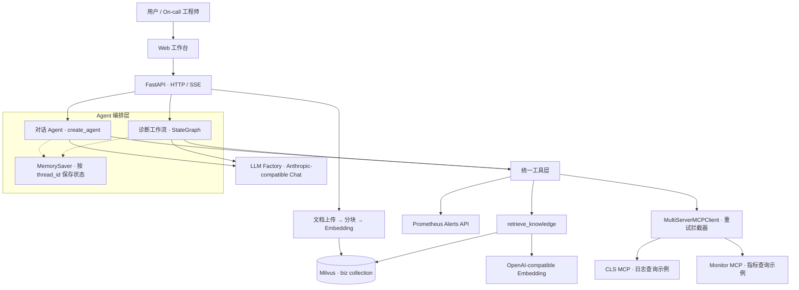

<div align="center">

# OpsAgent

### 让告警排查有计划，让运维经验可检索，让诊断过程看得见。

基于 **LangGraph + MCP + RAG** 的智能运维诊断 Agent

从自然语言提问，到工具查询、动态规划，再到 Markdown 诊断报告。


[功能亮点](#功能亮点) · [系统架构](#系统架构) · [实现原理](#实现原理) · [快速开始](#快速开始) · [架构详解](docs/ARCHITECTURE.md)

</div>

## 项目解决什么问题

一次告警排查往往需要在监控、日志和故障手册之间反复切换：确认受影响服务、对齐时间窗口、查询异常指标、阅读日志，再组织分析结论。

OpsAgent 将这些操作组织到一个可交互的 Agent 工作流中。用户可以直接询问运维问题，也可以启动一次系统告警诊断：由 Planner 制定步骤，Executor 调用工具采集信息，Replanner 根据结果决定继续、调整计划或生成报告。

项目提供可运行的 Web 界面、HTTP API、知识库入库链路和两个本地 MCP 示例服务，适合研究 Agent 编排、搭建运维助手原型和接入自己的可观测性系统。

> 当前版本定位为工程原型。仓库自带 CLS / Monitor MCP 服务使用模拟数据；Prometheus 告警工具调用配置地址的真实 HTTP API。生产化边界见[当前边界与演进方向](#当前边界与演进方向)。

## 功能亮点

| 能力 | 已实现内容 | 实现入口 |
| --- | --- | --- |
| 双链路 Agent | 对话式工具调用与专项运维诊断分别编排 | `rag_agent_service.py` / `aiops_service.py` |
| 动态诊断工作流 | Plan → Execute → Replan，支持继续、重规划、生成报告 | `app/agent/aiops/` |
| RAG 运维知识库 | Markdown / TXT 上传、分块、向量化、Milvus 检索 | `app/services/vector_*.py` |
| MCP 工具接入 | 多服务工具发现、工具调用、异常展开、指数退避重试 | `app/agent/mcp_client.py` |
| Prometheus 告警 | firing / pending 告警、完整 labels 身份、持续时间与状态统计 | `app/tools/query_metrics_alerts.py` |
| 实时反馈 | 对话文本流、诊断计划、步骤完成与报告等 SSE 事件 | `app/api/` |
| 多轮对话 | 使用 `thread_id` 和内存 Checkpointer 保存状态 | `rag_agent_service.py` |
| Web 工作台 | 快速问答、流式对话、知识上传、诊断进度与 Markdown 展示 | `static/` |

### 值得关注的工程设计

- **规划与执行分离**：Planner / Replanner 决定做什么，Executor 处理当前步骤；计划和重规划决策通过 Pydantic 模型约束结构。
- **知识库工具化**：对话 Agent 按需调用 `retrieve_knowledge`，运维 Planner 在规划前主动检索经验。
- **聊天与向量化解耦**：聊天使用 Anthropic Messages 兼容接口，Embedding 使用 OpenAI 兼容接口，分别配置模型与凭据。
- **统一工具注册**：知识检索、时间和 Prometheus 告警组成共享本地工具集，再合并 MCP 服务发现的工具。
- **流程可见**：把状态图节点更新转换为前端事件，展示计划、执行进度和最终报告。
- **保留告警身份**：使用完整 labels 识别 Prometheus 告警，避免不同实例的同名规则被错误合并。

## 系统架构



系统分为接口层、Agent 编排层、工具层和数据层：API 处理请求与事件，Agent 决定执行路径，工具封装知识检索和外部查询，Milvus 保存文档的语义索引。

## 实现原理

### 1. Plan–Execute–Replan：动态诊断


1. **Planner**：检索运维经验、读取工具说明，通过 `with_structured_output(Plan)` 生成有序步骤。
2. **Executor**：取出 `plan[0]`，向模型绑定本地与 MCP 工具，通过 `ToolNode` 执行工具调用并记录结果。
3. **Replanner**：结合原始任务、结果摘要和剩余计划，输出 `continue`、`replan` 或 `respond`；代码限制重规划长度和总执行步数。
4. **Report**：基于执行记录生成 Markdown 报告，包括告警清单、症状、日志证据、原因分析和处理建议；异常时返回已收集信息的后备报告。

状态由 `input`、`plan`、`past_steps`、`response` 组成。`past_steps` 使用追加式 reducer 保存记录，条件边决定继续还是结束。

当前 `/api/aiops` 使用“诊断系统当前告警”的固定任务模板；底层 `AIOpsService.execute()` 接收任务文本，可扩展其他诊断场景。

### 2. RAG：让故障手册进入推理上下文

```text
Markdown / TXT
    → 标题切分（Markdown）
    → 递归字符切分 + 小块合并
    → 添加文件名、来源路径、标题元数据
    → OpenAI-compatible Embedding
    → Milvus 向量索引

用户问题 → 查询向量 → Top-K 文档 → 资料内容及来源 → Agent 回答 / 诊断规划
```

Markdown 先按一级、二级标题切分，再执行字符切分与较短分片合并。检索文本包含文件来源与标题层级，帮助模型理解资料章节。

`aiops-docs/` 提供 CPU、内存、磁盘、服务不可用、响应变慢五类故障手册，可直接体验入库与检索。

### 3. MCP：把外部能力接成工具

`MultiServerMCPClient` 统一发现工具并转换为 LangChain 可调用对象。默认使用 `streamable-http`，也可通过环境配置接入 SSE 服务。

| 工具来源 | 示例能力 | 数据性质 |
| --- | --- | --- |
| 本地工具 | `retrieve_knowledge`、`get_current_time` | 知识库 / 本机时间 |
| Prometheus | `query_prometheus_alerts` | 配置的真实 Prometheus API |
| CLS MCP | 地域、日志主题、日志查询、时间戳 | 仓库内模拟实现 |
| Monitor MCP | CPU、内存指标 | 仓库内模拟实现 |

MCP 拦截器在异常时按指数退避重试，耗尽后返回显式错误结果。接入实际环境时，可以替换示例服务的数据查询实现，或配置自己的 MCP 地址。

### 4. SSE：两种粒度的实时输出

对话使用 `stream_mode="messages"` 提取模型文本块；诊断使用 `stream_mode="updates"` 在节点完成后发送 `plan`、`step_complete`、`report`、`complete` 等事件。

因此，普通对话支持文本增量输出；运维诊断展示步骤级进度，报告生成后整体返回。

完整调用链、状态流转和扩展入口见 [架构与源码导读](docs/ARCHITECTURE.md)。

## 快速开始

### 环境要求

- Python **3.11–3.13**，推荐 [uv](https://docs.astral.sh/uv/)。
- 支持 **Anthropic Messages API** 的聊天端点，以及匹配的模型和 Key。
- 使用 RAG 时需要 OpenAI 兼容 Embedding 服务、Docker 和 Milvus。
- 查询真实告警需要可访问的 Prometheus；项目不包含 Prometheus 服务。

### 1. 安装与配置

```bash
git clone https://github.com/wywzixin/OpsAgent.git
cd OpsAgent
uv sync --frozen
```

复制配置模板：

```bash
# Linux / macOS
cp .env.example .env
```

```powershell
# Windows PowerShell
Copy-Item .env.example .env
```

编辑 `.env`，填入自己的配置：

```dotenv
APP_NAME=OpsAgent
ANTHROPIC_API_KEY=your-anthropic-api-key
ANTHROPIC_BASE_URL=https://api.anthropic.com
ANTHROPIC_MODEL=your-chat-model
RAG_MODEL=your-chat-model

# 使用知识库时填写
EMBEDDING_API_KEY=your-embedding-api-key
EMBEDDING_BASE_URL=https://dashscope.aliyuncs.com/compatible-mode/v1
EMBEDDING_MODEL=text-embedding-v4
EMBEDDING_DIMENSIONS=1024

# 使用真实告警查询时填写
PROMETHEUS_BASE_URL=http://127.0.0.1:9090
```

`ANTHROPIC_BASE_URL` 必须支持 Messages 协议，不能直接替换为任意 OpenAI Chat Completions 地址。`RAG_MODEL` 当前优先于 `ANTHROPIC_MODEL`，建议填相同的实际模型名；使用 Grok 等兼容网关模型时，需要同时填写该网关的端点。

Key 从环境变量或本地 `.env` 读取。`.env`、日志、上传资料、数据库卷和虚拟环境均被 Git 忽略。

### 2. 启动向量库与 MCP 示例服务

```bash
docker compose -f vector-database.yml up -d
```

等待 Milvus 就绪，在两个终端分别运行：

```bash
uv run --frozen python mcp_servers/cls_server.py
```

```bash
uv run --frozen python mcp_servers/monitor_server.py
```

默认 MCP 地址为 `http://localhost:8003/mcp` 和 `http://localhost:8004/mcp`。

### 3. 启动应用

```bash
uv run --frozen uvicorn app.main:app --host 127.0.0.1 --port 9900
```

- Web 工作台：[http://localhost:9900](http://localhost:9900)
- API 文档：[http://localhost:9900/docs](http://localhost:9900/docs)
- 健康检查：[http://localhost:9900/health](http://localhost:9900/health)

也可在配置好环境后，使用 `start-windows.bat` 或 `make init` 启动本地完整演示环境。

### 4. 导入故障手册

在 Web 界面上传 `aiops-docs/` 中的 Markdown，或执行：

```bash
curl -X POST http://localhost:9900/api/upload -F "file=@aiops-docs/cpu_high_usage.md"
```

然后尝试“CPU 使用率持续升高应该怎么排查？”，或在工作台启动智能运维诊断。

## API 一览

| 方法 | 路径 | 用途 |
| --- | --- | --- |
| `POST` | `/api/chat` | 一次性返回答案 |
| `POST` | `/api/chat_stream` | SSE 对话文本流 |
| `POST` | `/api/aiops` | SSE 运维诊断 |
| `POST` | `/api/upload` | 上传 Markdown / TXT 并尝试建立索引 |
| `POST` | `/api/index_directory` | 索引本地资料目录 |
| `GET` | `/api/chat/session/{session_id}` | 会话历史查询接口 |
| `POST` | `/api/chat/clear` | 清除对话状态 |
| `GET` | `/health` | 应用与 Milvus 状态 |

```bash
# 对话
curl -X POST http://localhost:9900/api/chat \
  -H "Content-Type: application/json" \
  -d '{"Id":"demo-chat","Question":"CPU 使用率过高时应该如何排查？"}'

# 独立诊断建议使用新的 session_id
curl -N -X POST http://localhost:9900/api/aiops \
  -H "Content-Type: application/json" \
  -d '{"session_id":"diagnosis-001"}'
```

## 项目结构

```text
OpsAgent/
├── app/
│   ├── main.py                    # FastAPI 入口与生命周期
│   ├── config.py                  # Pydantic Settings
│   ├── api/                       # 对话、诊断、上传、健康检查
│   ├── agent/
│   │   ├── mcp_client.py          # MCP 发现、重试、错误处理
│   │   └── aiops/                 # Planner / Executor / Replanner / State
│   ├── services/                  # Agent、分块、Embedding、向量索引
│   ├── tools/                     # 知识库、时间、Prometheus
│   ├── core/                      # LLM Factory、Milvus 连接管理
│   ├── models/                    # 请求与响应模型
│   └── utils/                     # Loguru 日志
├── mcp_servers/                   # CLS / Monitor 模拟 MCP 服务
├── aiops-docs/                    # 五类故障排查手册
├── static/                        # 原生 JavaScript Web 工作台
├── docs/ARCHITECTURE.md            # 架构、源码与扩展点
├── .env.example                   # 无真实 Key 的配置模板
├── vector-database.yml            # Milvus / etcd / MinIO / Attu
├── pyproject.toml
└── uv.lock
```

## 当前边界与演进方向

当前版本聚焦诊断与建议，不执行自动修复操作。接入真实业务前，建议优先完善：

| 方向 | 当前边界 / 下一步 |
| --- | --- |
| 执行闭环 | Executor 当前仅执行一轮工具调用；补充有限工具循环与跨步骤证据传递 |
| 状态隔离 | 内存 Checkpointer，复用诊断 ID 会累积历史；引入独立 run_id 与持久化 |
| 对话上下文 | 历史接口需适配 Checkpointer 返回类型，消息裁剪尚未接入 |
| 入库一致性 | 先删后写，上传成功不等于索引成功；增加原子切换、任务状态 |
| 数据保护 | 现有代码会删除重建维度不匹配的集合；仅使用独立演示库，接入已有数据前改为显式迁移 |
| 服务治理 | 补充鉴权、目录访问限制、HTML 清洗、请求预算与独立就绪检查 |
| 质量评测 | 尚无自动化测试套件与准确率基准；建设工具回放、故障案例和证据覆盖评测 |

## 技术栈

Python · FastAPI · LangChain · LangGraph · Pydantic · MCP / FastMCP · Milvus · Prometheus HTTP API · Loguru · JavaScript / SSE

## 致谢与许可

项目由原始 **SuperBizAgent** 代码整理而来，保留原作者 **chief** 的署名；当前以 **OpsAgent** 名称组织项目与文档。

采用 [MIT License](LICENSE)。欢迎围绕真实监控接入、Agent 执行可靠性和诊断评测提交 Issue / Pull Request。
